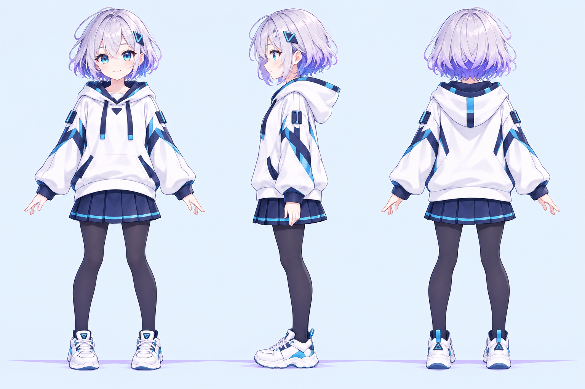

# shortcut 品牌娘设定

三视图是品牌娘的基础设定，供界面插画、分类图标和用户二创参考。

## 识别特征

- 银紫色短发，发梢带深紫色层次；青绿色眼睛。
- 佩戴青色几何箭头发夹，作为 shortcut 品牌标记。
- 白色连帽衫搭配海军蓝与青色线条；深蓝百褶裙、深色连裤袜和白色运动鞋。
- 整体用冰蓝、薰衣草紫、深海军蓝和青色；保持清爽、亲切、有行动力的感觉。

## 二创参考

可以调整姿势、表情、服装和场景，但建议保留银紫发色、青色箭头发夹和蓝白配色，方便识别为 shortcut 品牌娘。三视图及项目内配套图标按根目录 MIT 许可证提供；再发布作品时请保留许可证及来源说明。
