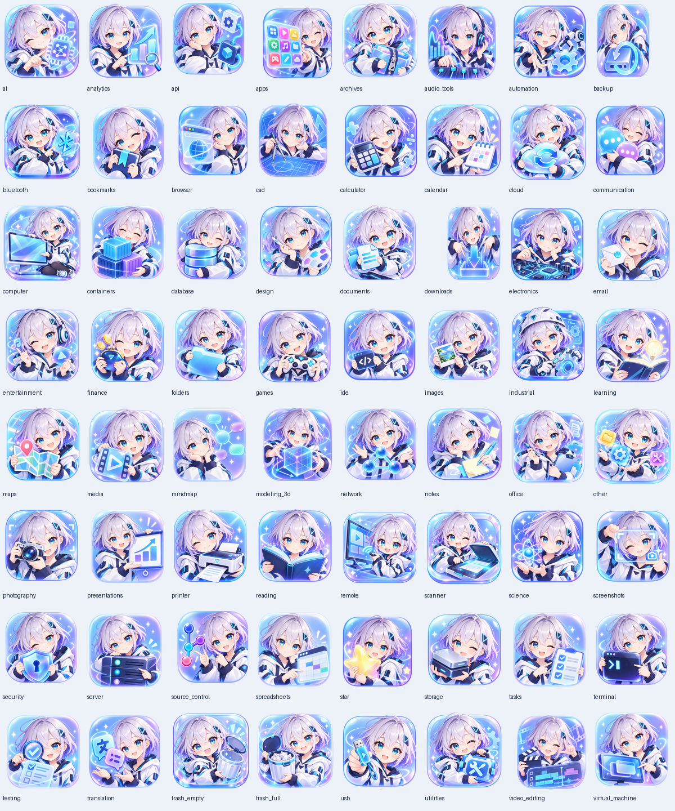

# 图标资源

当前应用使用 `assets/icons/shortcut-moe-v1/` 中的 **64 张 shortcut 品牌娘化分类与系统入口图标**。完整图片清单和中文分类名见同目录的 `manifest.json`。

- 每张图为 512 × 512 RGBA PNG，嵌入 sRGB 色彩配置，透明背景。
- 图标以品牌娘为统一角色，按分类内容搭配对应物件；采用冰蓝、薰衣草紫、青色和海军蓝微立体圆角风格。
- 图标用于 Shortcut 分类入口、系统入口及分类管理的图标选择器。分类内的软件和文件仍显示 Windows 提供的原图标。
- `work` 复用 `office`；`code` 复用 `ide`。
- 运行时只读取静态 PNG，不需要图像生成服务、AI 模型或推理依赖。
- 快捷栏保留 512 像素原图，按实际屏幕像素生成绘制缓存；125%、150%、200% 和 300% 缩放各自使用对应密度，悬停放大不会先缩成逻辑尺寸再拉伸。桌面盒缩略图及分类标题同样按屏幕密度绘制。

品牌娘三视图、识别特征和二创参考见[角色设定](CHARACTER_GUIDE.md)。

## 加载与替换

源码和 one-folder 构建都从 `assets/icons/shortcut-moe-v1/` 读取资源。图标通过 manifest 中的键和相对路径关联；替换图片时保留文件名、512 × 512 尺寸和 RGBA PNG 格式，重启后生效。

资源清单或图像无法读取时，加载错误会直接暴露，避免静默切换到旧图标或绘制占位图。未知分类键不在资源清单中时，调用方可选择自己的绘制方式。

新增可选择的分类图标时，需在 `manifest.json` 的 `icons` 和 `names` 中登记对应键、相对路径和中文名称。

## 设计范围

64 张图片覆盖分类与系统入口。偏好设置侧栏目前使用文字项；菜单中的排序、设置等操作符号由界面绘制，不属于这套分类图片资源。

## 来源

分类图标、品牌娘源图和三视图为 AI 辅助生成并整理的静态项目资源，按仓库根目录许可证提供。应用与托盘统一使用 `assets/branding/shortcut.ico`。
